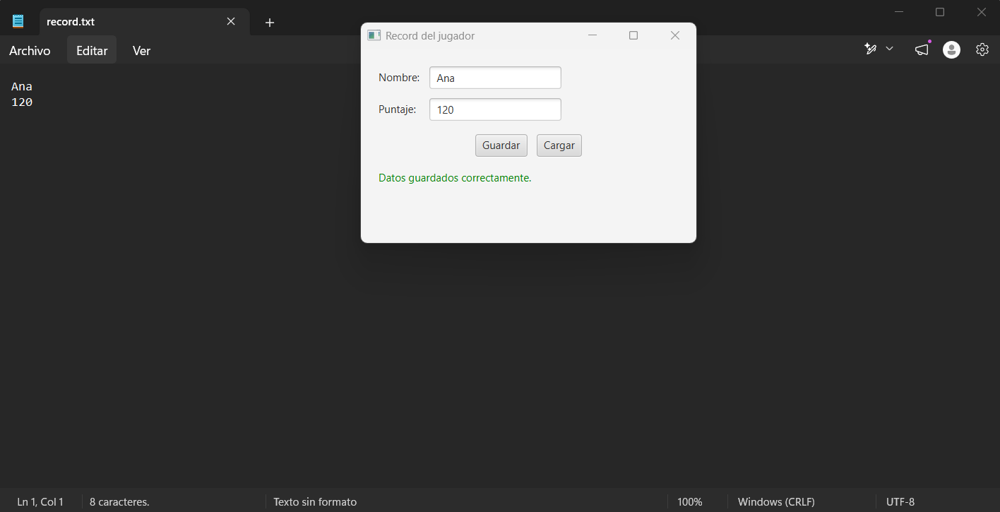
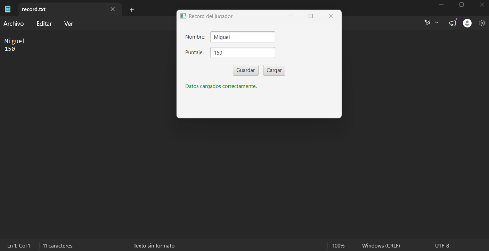
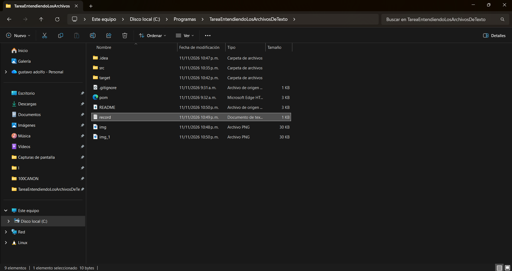
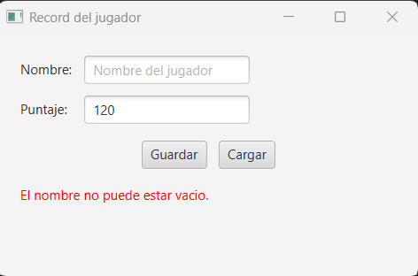
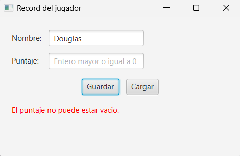
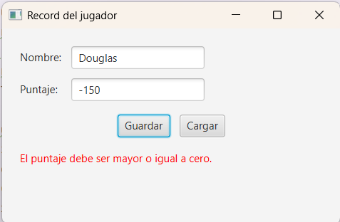
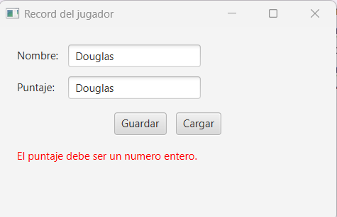
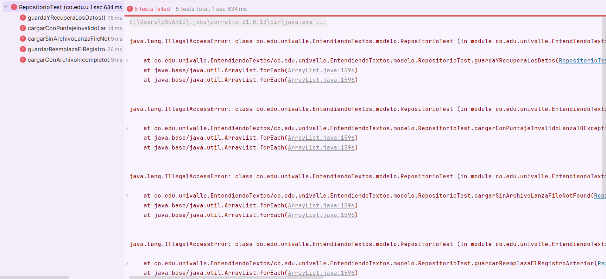
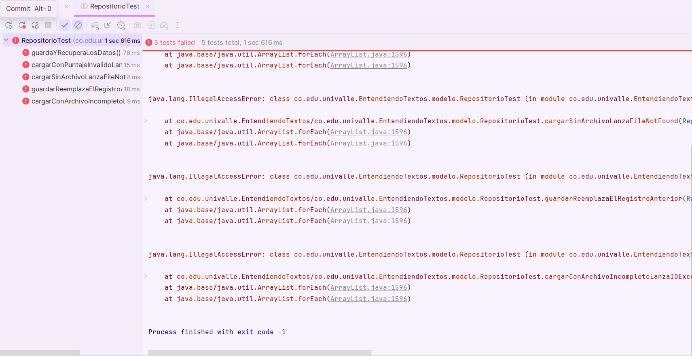

# Tarea Entendiendo Los Archivos De Texto.
Tarea propuesta por la profesora Paola Johanna Rodriguez, realizada por Douglas Velez Monginaite (202516737) para el curso de Fundamentos de Programación Orientado a Eventos.

## Dudas generadas en el desarrollo de la actividad.
1. Una duda que se me esta generando es como conectar el modelo con el controlador y la vista, creoq ue se basa en que en la primera entrega no hice esa parte y solo recibi la explicación de mi compañero.
2. Para realizar la clase vista se me complica la conexion de la interfaz con la función de los botones, es de nuevo la primera vez que hago esto.
3. Uso excepciones de acuerdo a lo recomendado por la IA para poder vitar errores, auqnue no me quda completamente claro como se realizan las conexiones de estas mismas.
4. Me toca explorar el Gridpane ya que se que es un contenedor de Java pero no se como usarlo bien.
5. La anotacion @Override tambien es algo que me recomienda claude, se que le dice al compilador como sobreescribir el metodo, pero lo use unicamente para solucionar un error que me aparecia, no supe resolverlo sin ese override.
## Registro de Uso de la IA.
1. Le pido a Claude que em ayude con la estructura base, el module-info y el pom.xml
2. En el Controlador no me queda claro como hacer la conexion con la vista, le pido ayuda a claude y me recomienda usar las funciones getBtnGuardar y getBtnCargar.
3. Pido ayuda con la conexion de los botones en la clase vista para lo que claude me recomeinda usar un extend Vbox en la clase y luego definir cada boton por separado.
4. Claude me recomienda utilizar excepciones para poder evitar los errores de entrada y salida en el codigo, ya que los errores se pueden presentar en multiples circunstancias, pongo las excepciones en COntrolador y Repositorio.
5.Le pido a Claude que me ayude con el archivo de pruebas para poder realizar las comprobaciones requeridas por la profesora.
##Pruebas con el programa.
#El archivo guarda correctamente, y el txt se mantiene.

#El archivo se carga correctamente, y el txt se mantiene.

#El archivo txt esta en la razi del proyecto.

#Prueba de errores(Puntaje vacio,nombre vacio,abc,numero negativo).

##Archivo RepositorioTest con las pruebas en JUnit.
